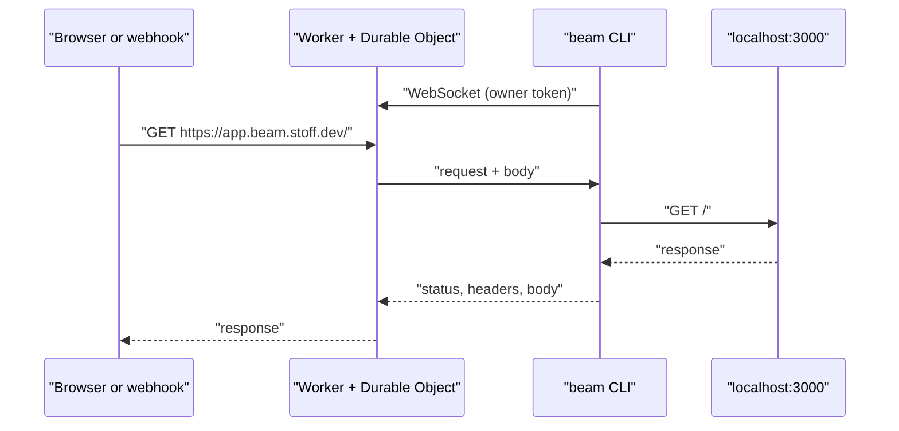

<div align="center">


# beam

**Your localhost, on the internet.**

Share a local port with a public https URL, WebSockets and all.

[](https://github.com/Stoffbergie/beam/actions/workflows/deploy.yml)
[](https://workers.cloudflare.com)
[](#install)
[](./LICENSE)

[Website](https://beam.stoff.dev) · [How it works](#how-it-works) · [Issues](https://github.com/Stoffbergie/beam/issues)

</div>

---

Run one command and your local server has a public https URL. Show a teammate your work in progress, test on your phone, or point an OAuth callback at it.

```console
$ beam 3000 -- npm run dev
https://k3m9xq2a.beam.stoff.dev → localhost:3000
GET     200  / 12ms
POST    200  /api/login 31ms
WS      101  /_hmr connected
```

Catching or replaying webhooks? That's [hook](https://github.com/Stoffbergie/hook).

## Features

- **One command.** `beam 3000` gives localhost:3000 a public URL. Add `-- npm run dev` and beam starts the app and waits for the port first.
- **Hot reload works.** WebSockets pass straight through, so dev servers behave like they do locally.
- **Streams both ways.** Large uploads and downloads stream instead of buffering.
- **Reconnects on its own.** Laptop sleeps, Wi-Fi drops, beam picks up the same URL where it left off.

## Install

```sh
brew install stoffbergie/tap/beam
```

For direct [Linux downloads](https://github.com/Stoffbergie/beam/releases/latest), the GNU x86_64 archive requires glibc 2.38 or newer, and the GNU ARM64 archive requires glibc 2.39 or newer. The `beam-x86_64-unknown-linux-musl.tar.gz` archive does not depend on glibc. No ARM64 musl archive is published.

beam serves content from your domain, so it needs the owner token. Set it once:

```sh
beam config --token <token>
```

## Use

| Do this                      | With                       |
| ---------------------------- | -------------------------- |
| Share localhost:3000         | `beam 3000`                |
| Start an app and share it    | `beam 3000 -- npm run dev` |
| Keep the same URL every time | `beam 3000 --name app`     |
| Share another local address  | `beam 127.0.0.1:8080`      |

## Security

Only the owner token can open a beam, so strangers can't serve pages from the domain. Nothing is stored: requests pass straight through to your machine, and a URL shows an offline page as soon as beam stops.

## Limits

| Item          | Limit                         |
| ------------- | ----------------------------- |
| Response wait | 100 seconds                   |
| Lifetime      | While the beam CLI is running |

## How it works



One Cloudflare Worker serves the website and every `*.beam.stoff.dev` URL. Each beam is a Durable Object that relays traffic to the CLI over one WebSocket. The CLI is a small Rust binary that forwards each request to your local server and streams the response back.

## Development

Requires [Vite+](https://viteplus.dev) and Rust.

```sh
vp install
vp dev
cargo run --manifest-path cli/Cargo.toml -- --help
```

| Command        | What it does                                                           |
| -------------- | ---------------------------------------------------------------------- |
| `vp dev`       | Run the Worker locally                                                 |
| `vp run check` | Format, lint and type-check both halves, then run the end-to-end tests |
| `vp test`      | End-to-end tests with the real Worker, the real CLI and local servers  |
| `vp build`     | Build the Worker for deployment                                        |

Pushing to `main` runs the checks, deploys to Cloudflare and smoke-tests production. Pushing a `v*` tag builds the CLI for macOS, Linux and Windows, and the Homebrew tap picks up the new release within the hour.

## License

[MIT](./LICENSE) © Dirk Beukes
