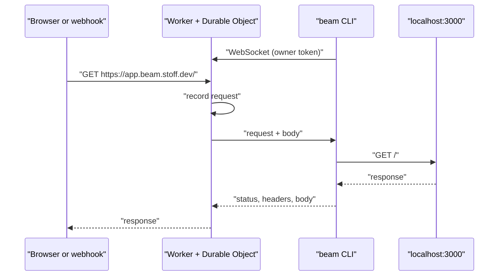

<div align="center">


# beam

**Your localhost, on the internet.**

Share a local port with a public URL, or catch and replay webhooks. No accounts.

[](https://github.com/Stoffbergie/beam/actions/workflows/deploy.yml)
[](https://workers.cloudflare.com)
[](#install)
[](./LICENSE)

[Website](https://beam.stoff.dev) · [How it works](#how-it-works) · [Issues](https://github.com/Stoffbergie/beam/issues)

</div>

---

Run one command and your local server has a public https URL. Every request that passes through is recorded, so you can inspect webhooks and replay them later.

```console
$ beam 3000 -- npm run dev
https://app.beam.stoff.dev → localhost:3000
Watch in a browser: https://beam.stoff.dev/app#5Yc0…
GET     200  /                    12ms
POST    200  /api/stripe          31ms
WS      101  /_hmr                connected
```

## Features

- **One command.** `beam 3000` gives localhost:3000 a public URL. Add `-- npm run dev` and beam starts the app and waits for the port first.
- **Hot reload works.** WebSockets pass straight through, so dev servers behave like they do locally.
- **Every request recorded.** Method, path, headers and body for the latest 100 requests, live in your terminal or a browser.
- **Replay webhooks.** Send a captured request to your server again, signature headers and all, even if it arrived while your server was down.
- **Catch without a server.** `beam` on its own, or one curl, gives a URL that records whatever is sent to it. Anyone can make one.
- **Reconnects on its own.** Laptop sleeps, Wi-Fi drops, beam picks up where it left off.

## Install

```sh
brew install stoffbergie/tap/beam
```

Forwarding a port needs the owner token, set once:

```sh
beam config --token <token>
```

## Use

| Do this                         | With                        |
| ------------------------------- | --------------------------- |
| Share localhost:3000            | `beam 3000`                 |
| Start an app and share it       | `beam 3000 -- npm run dev`  |
| Keep the same URL every time    | `beam 3000 --name app`      |
| Catch requests in your terminal | `beam`                      |
| Replay the latest request       | `beam replay app --to 3000` |
| Watch a beam                    | `beam watch app`            |
| List and delete beams           | `beam ls`, `beam rm app`    |

Each beam has a watch link like `https://beam.stoff.dev/app#key` that shows requests live in a browser.

<details>
<summary><strong>Catch webhooks with curl, for scripts and AI agents</strong></summary>

<br>

Create a catching URL. The response has the URL, an `X-Beam-Key` header and an `X-Beam-Watch` link:

```sh
curl -i -X POST https://beam.stoff.dev
```

Send it anything. It records the request and replies `ok`:

```sh
curl https://<name>.beam.stoff.dev/stripe -d '{"paid":true}'
```

Read what arrived, as JSON:

```sh
curl -H 'Authorization: Bearer <key>' https://beam.stoff.dev/<name>
curl -H 'Authorization: Bearer <key>' https://beam.stoff.dev/<name>/requests/<id>
```

Delete it:

```sh
curl -X DELETE -H 'Authorization: Bearer <key>' https://beam.stoff.dev/<name>
```

Add `-H 'Accept: application/json'` when creating to get JSON back. Errors are plain text: 401 missing key, 403 owner only, 404 unknown beam, 429 too many requests. `curl https://beam.stoff.dev` prints the full usage.

</details>

## Security

Catching URLs only ever reply `ok`, so anyone can create them. Forwarding serves real content from your domain, so it needs the owner token, and strangers can't host pages on it. Reading a beam's requests needs its key, which stays in the `#` part of the watch link and never appears in server logs. Beams and everything they recorded are deleted 7 days after their last request.

## Limits

| Item          | Limit                 |
| ------------- | --------------------- |
| Lifetime      | 7 days after last use |
| Requests kept | Latest 100 per beam   |
| Body kept     | 1 MB per request      |
| Response wait | 100 seconds           |
| New beams     | 30 per minute per IP  |

## How it works



One Cloudflare Worker serves the website, the API and every `*.beam.stoff.dev` URL. Each beam is a Durable Object that stores its latest requests in SQLite, streams them to anyone watching, and relays traffic to the CLI over one WebSocket. The CLI is a small Rust binary that forwards each request to your local server and streams the response back.

## Development

Requires [Vite+](https://viteplus.dev) and Rust.

```sh
vp install
vp dev
cargo run --manifest-path cli/Cargo.toml -- --help
```

| Command        | What it does                                                           |
| -------------- | ---------------------------------------------------------------------- |
| `vp dev`       | Run the Worker locally                                                 |
| `vp run check` | Format, lint and type-check both halves, then run the end-to-end tests |
| `vp test`      | End-to-end tests with the real Worker, the real CLI and local servers  |
| `vp build`     | Build the Worker for deployment                                        |

Pushing to `main` runs the checks, deploys to Cloudflare and smoke-tests production. Pushing a `v*` tag builds the CLI for macOS, Linux and Windows and updates the Homebrew formula.

## License

[MIT](./LICENSE) © Dirk Beukes
